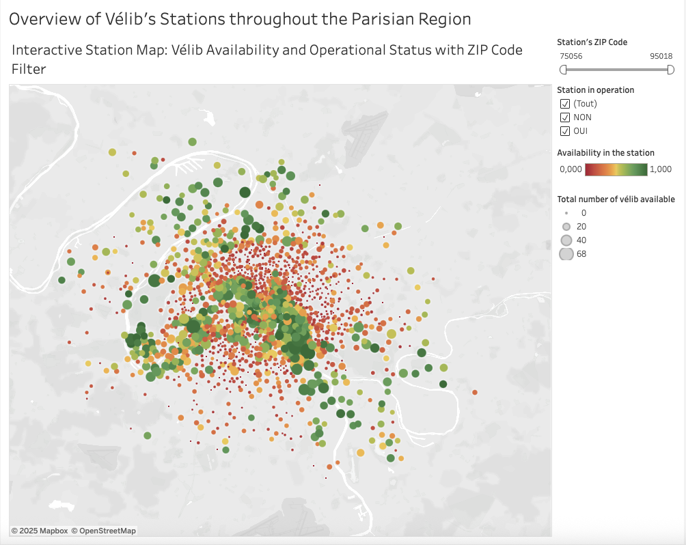
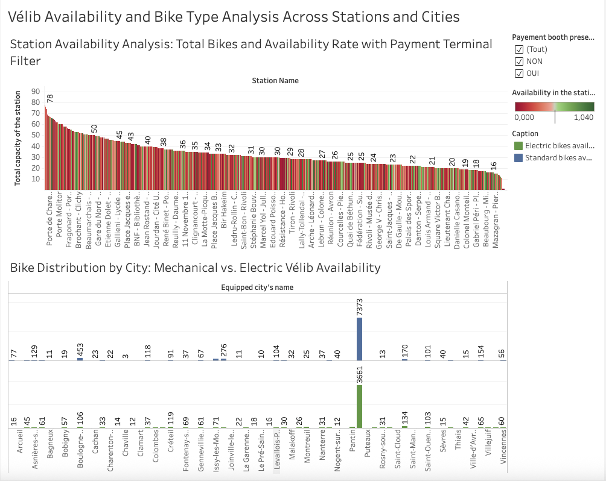

## Paris Vélib Stations Analysis

This was my first project using Tableau, and it served as an excellent introduction to the software. Working through this project helped me understand its core features, user interface, and how to create meaningful visualizations. It was an invaluable experience that allowed me to grasp Tableau’s capabilities and workflow, laying a solid foundation for future data analysis and visualization tasks.

#### Objectives

The primary goal of this project was to analyze and visualize the real-time status and availability of Vélib bike-sharing stations. The aim was to provide actionable insights into station functionality, bike availability, and the geographic distribution of bike types, thereby enhancing understanding of urban mobility patterns.

#### Data used

The dataset consisted of real-time availability data for Vélib stations, including geographic coordinates, the number of standard and electric bikes available, station operational status, and the presence of payment terminals. For this project, I used a CSV file containing a snapshot of the data captured on October 4th at 3:00 PM. This file was cleaned and prepared for integration into Tableau to enable dynamic exploration.

#### Analyses performed 

- **Interactive Map:** A map visualization displaying all Vélib stations, showing bike availability, station status (operational or not), and an availability rate calculated as the ratio of available bikes to total docks.

- **Histogram:** Visualizing bike availability by station, with a filter for stations equipped with payment terminals, allowing analysis of the influence of payment infrastructure on availability.
- **Bar Chart:** Presenting the count of mechanical and electric bikes per commune, showing spatial distribution and bike type preference trends.

Together, these analyses give a multi-faceted view of Vélib’s operational status and facilitate data-driven decisions and urban planning.

#### Possible Improvements

A significant improvement for this project would be to replace the CSV static data source with direct API integration. Using the Vélib API as the data input would allow the dashboard to automatically fetch up-to-date information on bike availability, station status, and other metrics in near real-time without manual data imports. This would enable continuous, automated data refreshes, providing users with the most current view of the Vélib network at any time. It would greatly enhance the dashboard’s relevance while reducing maintenance efforts.
The approach to implementing this involves creating a Web Data Connector (WDC) to serve as a bridge for Tableau to fetch live API data, connecting it to Tableau Online, and scheduling refresh intervals to keep the dashboards updated.

##### Link to the project

[View the Dashboard](https://prod-ch-a.online.tableau.com/#/site/clarablanchard-c9d8574f75/workbooks/132154?:origin=card_share_link)

[Link to the data](https://opendata.paris.fr/explore/dataset/velib-disponibilite-en-temps-reel/export/?disjunctive.is_renting&disjunctive.is_installed&disjunctive.is_returning&disjunctive.name&disjunctive.nom_arrondissement_communes)
