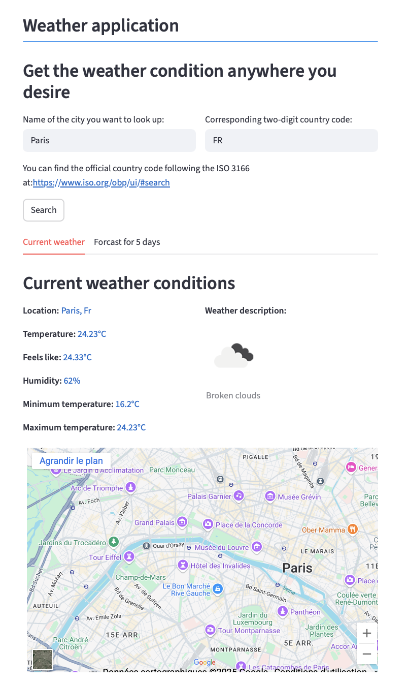
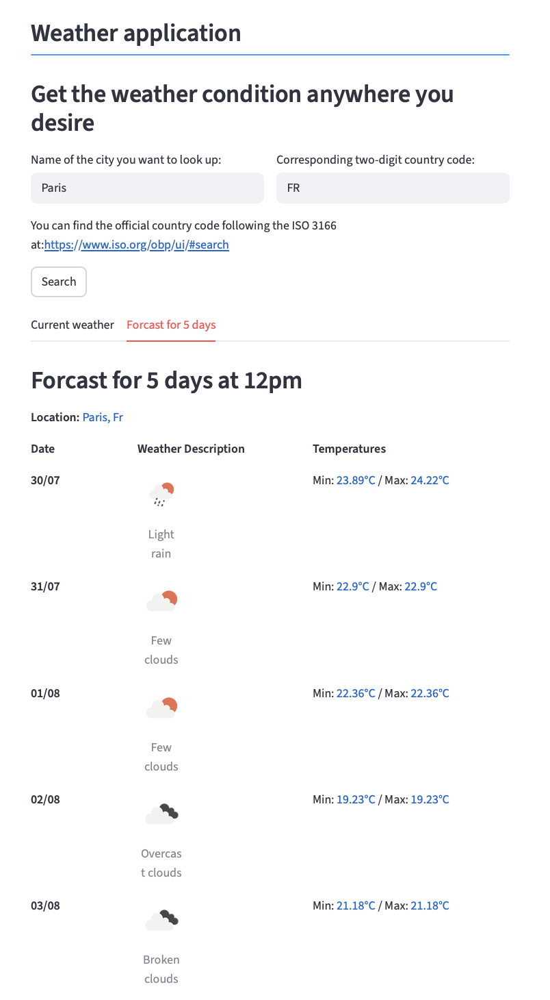

## Weather App 

> My first ever project

Weather App is a web-based application built with Python and Streamlit.  
It provides real-time weather updates, a 5-day forecast, and an interactive map  
for any city in the world, by leveraging the OpenWeatherMap and Google Maps APIs.

### Main Features

- Search weather conditions by city and country
- Detailed weather: temperature, humidity, feels-like, and description
- 5-day forecast centered around noon each day
- Dynamic Google Maps view of the selected location
- Modern, responsive UI powered by Streamlit

### Screenshots

Current weather screen:

5-day forecast screen:

### Tech Stack

**Python 3.9+, Streamlit, requests, python-dotenv, OpenWeatherMap API, and Google Maps Embed API**

### Source Code

### About the Project

I designed and developed this Weather App from start to finish as a way to showcase my skills in Python development, API integration, and interactive web app design.
An interesting challenge was that this was my very first project using Git and APIs, making it a valuable introduction to real-world situations. This experience allowed me to face and overcome practical difficulties, building both my technical abilities and my problem-solving confidence.

